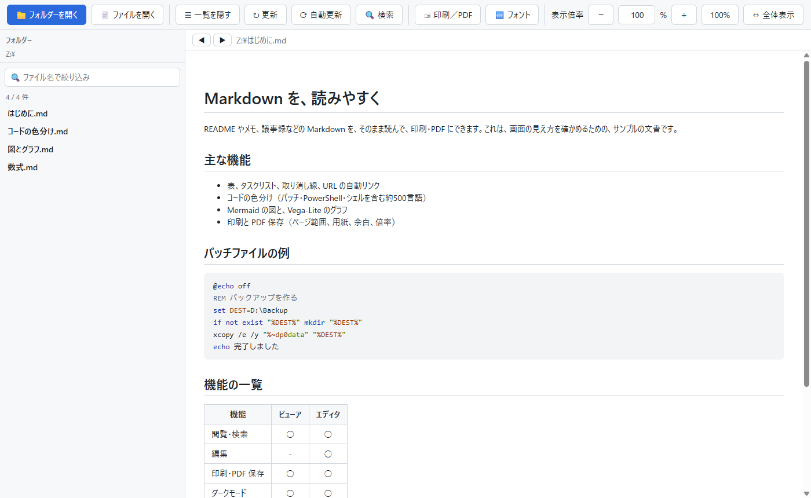

# Handy Markdown Viewer

<picture>
  <source media="(prefers-color-scheme: dark)" srcset="docs/images/MarkdownViewer-dark.png">
  
</picture>

Windows 11 向けの、Markdown 閲覧専用アプリです。フォルダーの中の Markdown を一覧から選んで読み、そのまま印刷・PDF 保存できます。文書は書き換えません（書くときは、姉妹アプリの Markdown エディタを使います）。

Python と pywebview で作り、描画は Microsoft Edge の WebView2 を使います。

## 主な機能

- フォルダーの一覧から文書を選んで読む。サブフォルダーは階層で開閉できる。ファイル名での絞り込み
- 複数のウィンドウ（ずらして開く。一覧・リンクの Ctrl+クリックや右クリックで、新しいウィンドウで開く。設定ファイルは、同時に使っても壊れない形で書く）
- 戻る・進む（開いたファイルの履歴。読んでいた位置も戻る。Alt+←／Alt+→）
- 自動更新（開いているファイルが他のアプリで保存されたら、読んでいる位置を保ったまま表示を更新する）
- 文書内の検索（全件ハイライト、正規表現、次へ・前へ）と、**フォルダー全体の本文の検索**（一致した行をファイルごとに一覧し、押すとその行へ移る）
- 表（列の配置）、タスクリスト、取り消し線、URL の自動リンク、日本語の強調記号
- コードの色分け（` ```bat ` のように言語名を書く。バッチ・PowerShell・シェルを含む約500言語）
- **脚注**（`[^1]`）、**Qiita の注釈ブロック**（`:::note info` / `warn` / `alert`）、**GitHub のアラート**（`> [!NOTE]` など）、コードブロックのファイル名（` ```ruby:app.rb `）と差分（` ```diff_ruby `）
- **発表（スライドショー）**（`---` でスライドに区切り、全画面で発表。モニターを選べる・発表者ビュー（次のスライド・ノート・タイマー）・スライド一覧・暗転・レーザーポインター・部分拡大・デザインのテーマ（CSS で自作できる）・PDF／配布資料／HTML スライドショーへの保存）
- Mermaid の図、Vega-Lite のグラフ
- 数式（` ```math `、`$$ … $$`、文中の `$…$`。KaTeX で組む。ダークモード・印刷・PDF に対応）
- ローカルの画像（相対パス・絶対パス・`file:///`）
- **HTML への書き出し**（数式・Mermaid・Vega-Lite・コードの色分け・画像も含めて、1つで完結する HTML ファイルに。ネットがなくても同じ見た目で読める）
- 印刷と PDF 保存（ページ範囲、用紙・向き・余白・倍率、改ページの指定）
- 表示倍率、フォントの設定、ダークモード（Windows の設定に従う）
- ウィンドウへのドラッグ＆ドロップ、フォルダーの右クリックから開く

## 使う

インストールは不要です。ビルド済みの `MarkdownViewer.exe` を起動します。

```
MarkdownViewer.exe [ファイル.md | フォルダー]
MarkdownViewer.exe --register     エクスプローラーの「プログラムから開く」に登録
MarkdownViewer.exe --unregister   登録を解除
```

動作環境は、Windows 11 と Microsoft Edge WebView2 ランタイムです。使い方の詳細は [取扱説明書](docs/取扱説明書.md) を見てください。

ダークモードは、アプリの設定ではなく、**Windows の設定に自動で従います**。切り替えるときは、Windows の「設定」→「個人用設定」→「色」→「モードを選ぶ」で、「ダーク」または「ライト」を選びます。

## 開発

```
python -m venv .venv
.venv\Scripts\python -m pip install -r requirements.txt
.venv\Scripts\python mdviewer.py [ファイル.md | フォルダー]
```

| 目的 | コマンド |
| --- | --- |
| テスト | `.venv\Scripts\python -m pytest` |
| 画面を実際に動かす確認 | `.venv\Scripts\python tests\gui_check_search.py`（`tests\gui_check_*.py`。設定は一時フォルダーに向ける） |
| exe を作る（テスト → PyInstaller） | `.\build.cmd` |
| 配布用 zip を作る | `python tools\make_release.py` |
| README のスクリーンショットを撮り直す（先に `.\build.cmd`） | `pwsh .\tools\make_screenshots.ps1`（`docs\sample` のサンプル文書を、ライトとダークで撮る） |

主なファイル:

| ファイル | 役割 |
| --- | --- |
| `mdviewer.py` | 本体。Markdown を HTML にして、画面（`ui.html`）へ渡す |
| `ui.html` / `vfind.js` / `print.js` | 画面、文書内検索、印刷ダイアログ |
| `sanitize.py` | 埋め込み HTML の許可リスト方式の除去 |
| `highlight.py` | コードの色分け（Pygments） |
| `autolink.py` / `cjk_emphasis.py` | URL の自動リンク、日本語の強調記号 |
| `printing.py` / `shellreg.py` / `filedrop.py` / `uiprefs.py` | 印刷・PDF、エクスプローラーへの登録、ドロップ、設定の保存 |
| `vendor/` | 同梱の外部ライブラリ（Mermaid、Vega / Vega-Lite / vega-embed、iconify の `logos` アイコン集） |

設計や仕様は [簡易仕様書](docs/簡易仕様書.md) にあります。

## 補足

- ライセンスは [MIT](LICENSE) です（Copyright (c) 2026 Hidetoshi 'PePe' Amemiya）。
- 同梱している第三者のライブラリ（Mermaid、Vega、CodeMirror、iconify の `logos`、Python など）のライセンス表示は、[THIRD_PARTY_NOTICES.md](THIRD_PARTY_NOTICES.md) にあります。配布 zip にも同じものを入れています。
- 姉妹アプリの Markdown エディタとは、`autolink.py`、`cjk_emphasis.py`、`sanitize.py`、`highlight.py` などを、同じ内容で持っています。
